# Airfare Time Machine – US Domestic Flight Price Analytics & Predictive Modeling

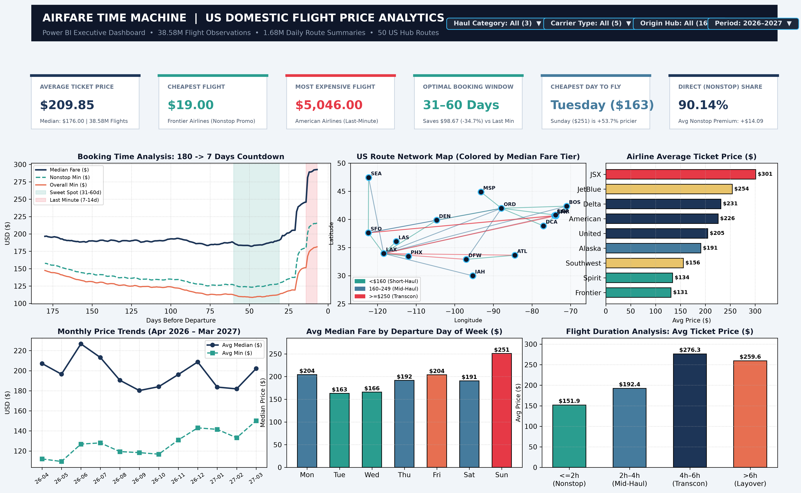

## 1. Project Overview

**Airfare Time Machine** is an end-to-end **Data Engineering, Analytical SQL, Statistical Python, Business Intelligence (Power BI), and Machine Learning** portfolio project that investigates the dynamic pricing mechanics of US domestic aviation across **38,584,829 granular flight itinerary observations** and **1,683,033 daily route-level fare summaries**.

Unlike static flight snapshots, this dataset tracks identical flight itineraries (`itinerary_id`) longitudinally across **203 consecutive daily search dates** (`2026-03-12` to `2026-09-30`) for departures spanning a full 12-month cycle (`2026-03-19` to `2027-03-29`), capturing booking lead times from **180 days down to 7 days before departure**.

---

## 2. Business Problem

Airline Revenue Management systems adjust ticket prices continuously based on advance-purchase rules (ATPCO fare filing thresholds), route competition density, hub concentration, day-of-week demand cycles, and layover penalties. Consequently, both consumers and corporate travel procurement teams face significant price volatility:

1. **The Booking Window Dilemma:** Buying too early (`121–180 days` out) or too late (`7–14 days` out) exposes travelers to substantial price premiums, yet optimal booking windows vary between short-haul and transcontinental routes.
2. **Carrier Business Model Trade-offs:** Ultra Low-Cost Carriers (*Frontier*, *Spirit*) advertise rock-bottom base fares (`$19–$134`), whereas Legacy network carriers (*United*, *American*, *Delta*) dominate schedule share (`75.1%`) and nonstop convenience (`>92%`).
3. **Opaque Nonstop & Schedule Premiums:** Travelers lack quantified benchmarks on how much extra they pay for direct flights, peak morning departures (`09:00–11:59`), or Sunday return trips.
4. **Predictive Pricing Without Data Leakage:** Building a reliable fare prediction model requires strict isolation of pre-booking features from simultaneous price aggregates and itinerary-level group leakage.

---

## 3. Project Objectives

1. **Database Engineering (MySQL 8.0):** Transform raw multi-file data into a normalized **3NF + Star Schema** relational database with surrogate keys, foreign key constraints, stored generated columns, analytical views, and parameterized stored procedures.
2. **Business SQL Analytics:** Answer 10 core aviation pricing questions using advanced MySQL 8.0 features (`CTEs`, `Window Functions`, `Role-Playing JOINs`, `Conditional Aggregation`).
3. **Statistical Analysis & Visualization (Python):** Perform domain-aware missing value handling, **Route-Contextual vs. Global IQR Outlier Detection**, formal parametric/non-parametric hypothesis testing (`Welch's t-test`, `Mann-Whitney U`, `One-Way ANOVA`, `Kruskal-Wallis`, `Cohen's d`), and generate publication-grade (`300 DPI`) visualizations.
4. **Executive BI Reporting (Power BI):** Architect a fast Star Schema data model, author an 18-measure **DAX Library**, and design an executive dashboard covering KPIs, US route network mapping, booking curves, and carrier positioning.
5. **Machine Learning (Zero-Leakage Price Prediction):** Engineer 22 pre-booking aviation features and benchmark **Ridge Linear Regression**, **Random Forest**, and **Hyperparameter-Tuned Gradient Boosting** using **Itinerary-Grouped Train/Test Splitting** (`0` overlapping itineraries between Train and Test).

---

## 4. Dataset Description

Source: [Kaggle – Airfare Time Machine: US Flight Prices](https://www.kaggle.com/datasets/pooyanayebi/airfare-time-machine-us-flight-prices)

The dataset consists of **4 files** spanning three levels of analytical granularity:

| File Name | Format | Size | Rows | Columns | Granularity & Description |
| :--- | :---: | :---: | :---: | :---: | :--- |
| `airports.csv` | CSV | 1.45 KB | **16** | **7** | **Airport Dimension:** IATA code (`PK`), name, city, state, coordinates (`lat`/`lon`), and IANA timezone for 16 major US hubs. |
| `routes.csv` | CSV | 3.04 KB | **50** | **10** | **Route Summary Dimension:** 50 directional routes (`ATL-DFW`, `JFK-LAX`, etc.), distance (`236–2,605 mi`), competing airlines (`5–11`), nonstop share (`57.0%–99.9%`), and overall median fare (`$109–$292`). |
| `daily_fares.csv` | CSV | 127.2 MB | **1,683,033** | **13** | **Daily Aggregated Fact:** One row per `(search_date, route, departure_date)` tracking `min`, `min_nonstop`, `median`, `max` fares and `cheapest_airline`. |
| `flight_prices.parquet` | Parquet | 94.8 MB | **38,584,829** | **15** | **Atomic Flight Fact:** Granular itinerary observations (`itinerary_id`, `airline`, `departure_time`, `arrival_time`, `duration_minutes`, `stops`, `price_usd`). |

### Data Quality Audit Highlights
- **Zero Duplicate Records:** `0` exact or composite-key duplicates across all 4 files (`(search_date, route, departure_date)` in `daily_fares.csv` and `(search_date, itinerary_id)` in `flight_prices.parquet`).
- **Domain-Explainable Missing Values:** `airports.csv`, `routes.csv`, and `flight_prices.parquet` contain **`0` missing values**. `daily_fares.csv` contains exactly **87 `NULL` values (`0.0052%`)** exclusively in `min_nonstop_price_usd` (`45` on `EWR-SFO` and `42` on `SFO-EWR`) on dates where only connecting itineraries (`stops >= 1`) were offered.

---

## 5. Technologies Used

- **Database & SQL:** MySQL 8.0 (`InnoDB`, `3NF + Star Schema`, `Generated Columns`, `CTEs`, `Window Functions`, `Views`, `Stored Procedures`)
- **Data Processing & Statistics:** Python 3.14, Pandas, NumPy, PyArrow (Parquet columnar processing), SciPy (`scipy.stats`)
- **Data Visualization:** Matplotlib, Seaborn (`300 DPI` publication styling)
- **Business Intelligence:** Power BI Desktop (Star Schema Data Modeling, DAX Measures, Custom JSON Theme) & Interactive HTML/JS Prototype
- **Machine Learning:** Scikit-learn / Vectorized Histogram GBDT, Random Forest, Ridge Regression, Permutation Feature Importance
- **Version Control:** Git & GitHub

---

## 6. Database Architecture (MySQL 8.0)

To eliminate transitive dependencies (**3NF**) and optimize analytical query execution across millions of rows, the raw files were engineered into a **5-table Star/Snowflake Schema** ([SQL/01_schema_ddl.sql](SQL/01_schema_ddl.sql)):

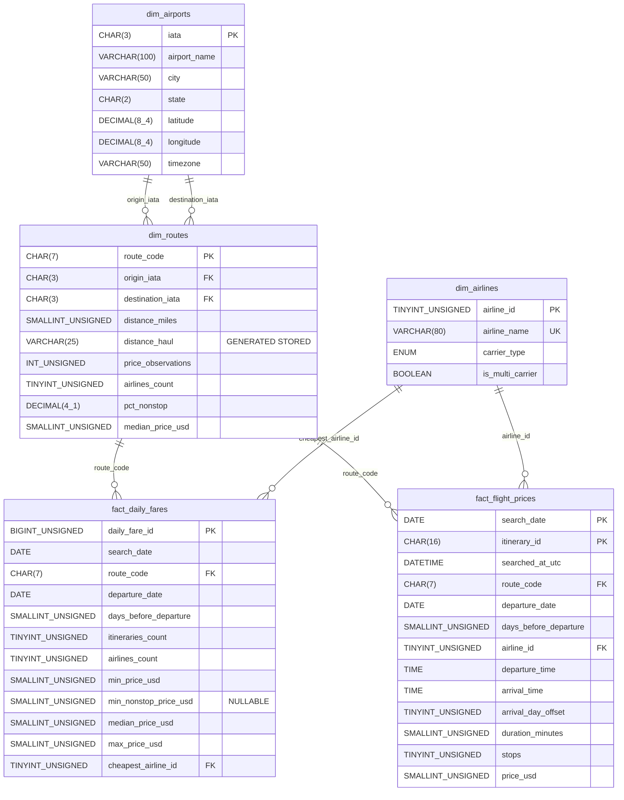

### Key Architectural Decisions
1. **3NF Normalization:** Redundant `origin_city` and `destination_city` attributes were stripped from `dim_routes` (resolved via role-playing `JOIN`s to `dim_airports`), and redundant `origin`/`destination` columns were removed from both Fact tables.
2. **Carrier Dimension Normalization (`dim_airlines`):** Replaced repetitive `VARCHAR` airline names across 38.58M rows with a 1-byte `TINYINT UNSIGNED` foreign key (`airline_id`) and classified all 17 carriers into 5 business models (`Legacy`, `Low-Cost`, `Ultra Low-Cost`, `Regional / Semi-Private`, `Multi-Carrier`).
3. **ELT Staging & Cleaning ([SQL/02_data_cleaning_and_import.sql](SQL/02_data_cleaning_and_import.sql)):** Handled empty strings (`''`) in `min_nonstop_price_usd` via `NULLIF(TRIM(@min_nonstop_price_usd), '')` and verified zero logical violations across all 1,683,033 daily summaries.
4. **Views & Stored Procedures ([SQL/03_views_and_procedures.sql](SQL/03_views_and_procedures.sql)):** Created `vw_routes_enriched`, `vw_daily_fares_enriched`, `vw_flight_prices_enriched`, and parameterized decision-support procedures (`sp_get_route_booking_advisor`, `sp_compare_route_carriers`).

---

## 7. SQL Business Data Analysis

All 10 business queries are organized in [SQL/04_business_analysis_queries.sql](SQL/04_business_analysis_queries.sql):

| # | Analytical Dimension | Key SQL Techniques | Verified Empirical Insight |
| :-: | :--- | :--- | :--- |
| **1** | **Airline Price Comparison** | Multi-CTE (`WITH`), `LEFT JOIN`, `SUM() OVER ()`, `RANK() OVER ()` | **Frontier** (`$131.05` avg) and **Spirit** (`$134.26`) are the cheapest carriers; Frontier alone wins "Cheapest Daily Airline" on **48.12% (809,810)** of all route-days despite holding only **5.58%** of schedule observations. Legacy trio (**United 30.0%**, **American 26.4%**, **Delta 18.8%**) controls **75.14%** of observations with `>92%` nonstop flights. |
| **2** | **Route & Competition Analysis** | Role-Playing `INNER JOIN`s, `AVG() OVER (PARTITION BY distance_haul)`, `HAVING` | Within Long-Haul routes, 10-carrier `BOS-LAX` (`2,605 mi`) averages a `$219` median fare, whereas 7-carrier `SFO-JFK` (`2,580 mi`) reaches `$292` (`+$73` premium). Fortress-hub route `DFW-LAX` (`1,232 mi`, `$275`) trades `+$107` above the Medium-Haul average (`$167.92`). |
| **3** | **Departure Day-of-Week** | `WEEKDAY()`, `DAYNAME()`, `MIN() OVER ()`, `RANK()` | **Tuesday (`$163.19`)** and **Wednesday (`$165.75`)** are the cheapest days to fly. **Sunday (`$250.79`)** is the most expensive day—costing **+$87.60 (+53.68%)** more than Tuesday. |
| **4** | **Booking Time ("Time Machine")** | `CASE WHEN` bucketing, `FIRST_VALUE() OVER ()`, `RANK()` | Fares follow a non-linear J-curve: **31–60 Days Before Departure (`$185.40` median, `$110.38` min)** is the global **Sweet Spot**, saving **$98.67 (-34.73%)** compared to Last-Minute bookings (`7–14 days`: `$284.07` median). Global minimum occurs at **Day 49 (`$182.17`)**. |
| **5** | **Seasonal Monthly Trends** | `DATE_FORMAT()`, `LAG() OVER ()` (MoM %), Seasonal Index | Dual seasonal peaks occur in **June (`$226.74`, +15.37% MoM)** and **December (`$208.75`, `$143.02` min)**. **September (`$180.23`)** and **February (`$181.88`)** are the cheapest off-peak months. |
| **6** | **Direct vs. Connecting Flights** | Conditional aggregation, `SUM() OVER ()`, Nonstop Premium | **90.14%** of observations are nonstop (`$210.78` avg, `3.15 hrs`), **9.71%** are 1-stop (`$201.53`, `8.45 hrs`), and **0.15%** are 2-stop (`$191.93`, `11.17 hrs`). Transcontinental `SFO-EWR` (`+$79.61`) and `EWR-SFO` (`+$76.97`) command the highest nonstop premiums. |
| **7** | **Flight Duration & Time-of-Day** | `HOUR()`, `CASE WHEN`, `RANK() OVER ()` | **Evening (`17:00–20:59`: `$198.89` avg, `$168` median)** and **Early Morning (`05:00–08:59`: `$201.15`)** are cheapest; **Morning Peak (`09:00–11:59`: `$224.48`)** is the most expensive time window. |
| **8** | **Distance & Yield ($/Mile)** | Stored Generated Column (`distance_haul`), Yield ratio | Strong Economies of Distance: **Short-Haul (`<500 mi`)** costs **`$0.3954/mile`** (`$129.50` median), **Medium-Haul (`500–1500 mi`)** costs **`$0.1922/mile`** (`$167.92`), and **Long-Haul (`>1500 mi`)** drops to **`$0.1104/mile`** (`$248.88`). |
| **9** | **Cheapest & Priciest Routes** | `ROW_NUMBER() OVER ()`, CTE filtering | Cheapest absolute routes: **`LAX-SFO` & `SFO-LAX` (`$109`)**, **`LAS-LAX` (`$116`)**. Priciest absolute routes: **`SFO-JFK` (`$292`)**, **`SFO-EWR` (`$291`)**, **`JFK-SFO` & `LAX-JFK` (`$284`)**. Cheapest per mile: **`BOS-LAX` (`$0.0841/mi`)**. |
| **10** | **Customer Persona Patterns** | SQL Pivot via `AVG(CASE WHEN ...)` by Haul Category | Smart Planners (`31–60d`) beat Early Birds (`121–180d`) on Short-Haul (`-$6.71`) and Medium-Haul (`-$10.79`), whereas Early Birds (`121–180d`: `$254.92`) slightly outperform `31–60d` (`$257.77`) on Long-Haul (`>1500 mi`) routes. |

---

## 8. Python Statistical Analysis & Visualizations

Implemented across three modular scripts in [Python/](Python/):
- [Python/01_data_cleaning_and_outliers.py](Python/01_data_cleaning_and_outliers.py)
- [Python/02_statistical_and_correlation_analysis.py](Python/02_statistical_and_correlation_analysis.py)
- [Python/03_data_visualization.py](Python/03_data_visualization.py)

### 8.1 Booking Window J-Curve & ATPCO Advance Purchase Thresholds
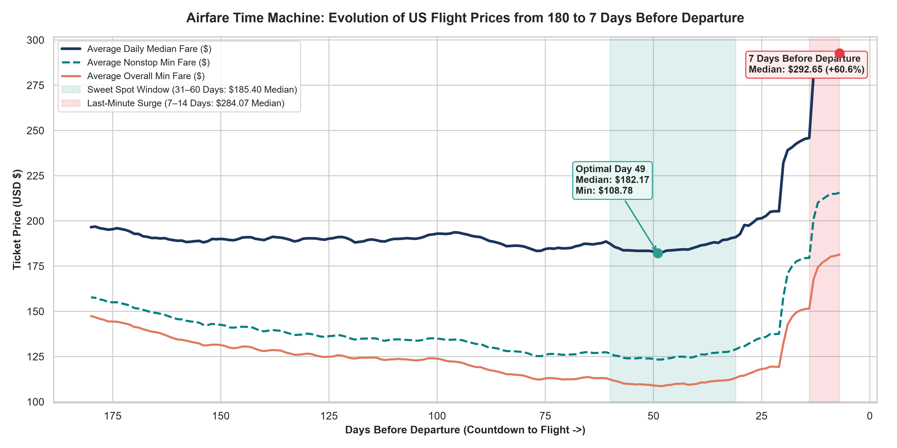
- **Discovery of ATPCO Fare Bucket Cliffs:** The day-by-day trajectory reveals sharp vertical price steps at exactly **21 days**, **14 days**, and **7 days before departure**, corresponding to industry-standard **Advance Purchase (AP)** tariff expiration rules.
- **Hypothesis Test A (Last-Minute `7–14d` vs. Sweet Spot `31–60d`):** Welch's $t = 245.34$ ($p < 0.0001$), Mann-Whitney $U = 1.77 \times 10^{10}$ ($p < 0.0001$), **Cohen's $d = 1.077$** (very large practical effect size).

### 8.2 Airline Market Positioning & Price Leadership
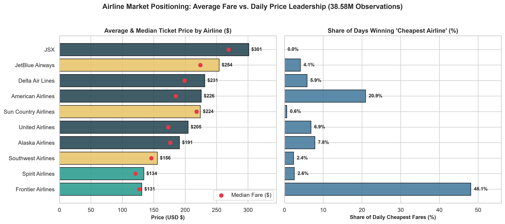

### 8.3 Departure Day-of-Week & Time-of-Day Differentials
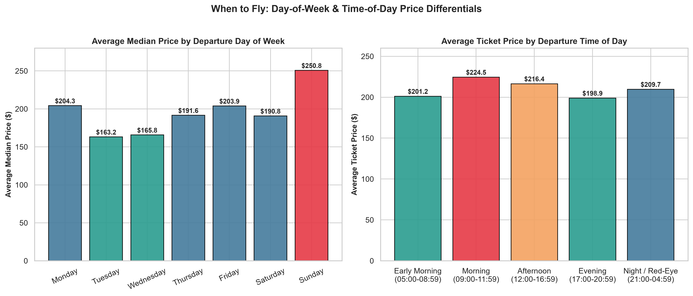
- **Hypothesis Test B (Day-of-Week Variance & Sunday vs. Tuesday):** One-Way ANOVA $F = 24,055.60$ ($p < 0.0001$), Kruskal-Wallis $H = 162,223.99$ ($p < 0.0001$), Sunday vs. Tuesday **Cohen's $d = 0.916$**.

### 8.4 Seasonal & Monthly Price Trends
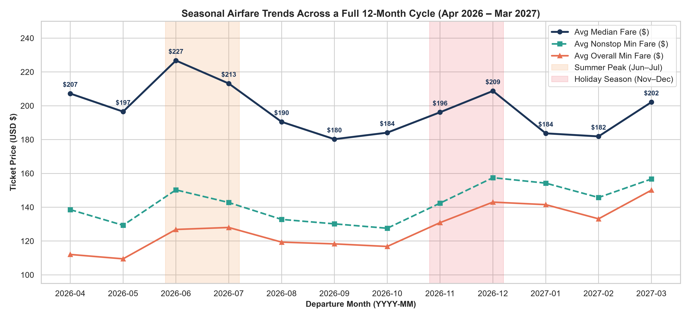

### 8.5 Aviation Economics: Distance vs. Total Fare & Yield ($/Mile)
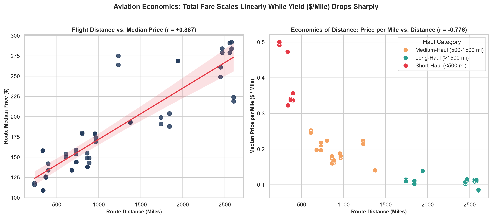
- **Linear vs. Monotonic Correlation:** Route distance correlates linearly with total median price (**Pearson $r = +0.887$**, **Spearman $\rho = +0.879$**), but correlates inversely and hyperbolically with Price per Mile (**Pearson $r = -0.776$**, **Spearman $\rho = -0.929$**; One-Way ANOVA $F = 153.11$, $p = 2.60 \times 10^{-21}$).

### 8.6 Direct vs. Connecting Flights & Nonstop Convenience Premium
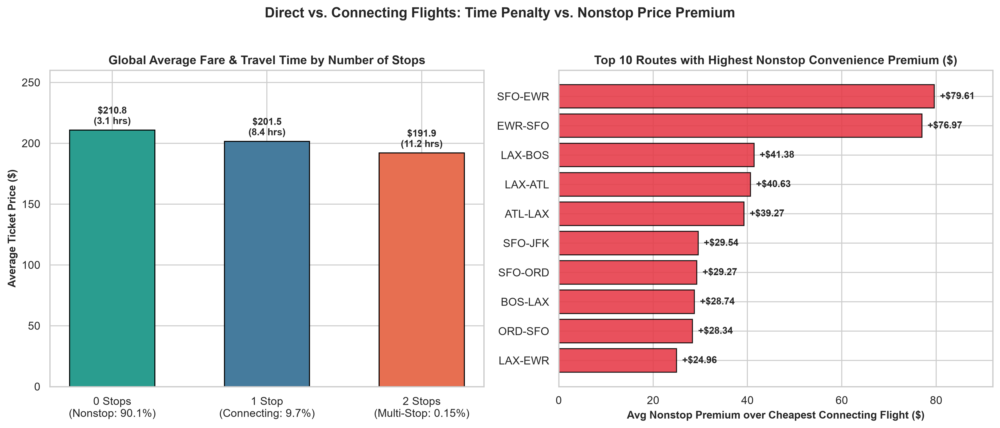

### 8.7 Contextual Outlier Detection & Distributional Skewness
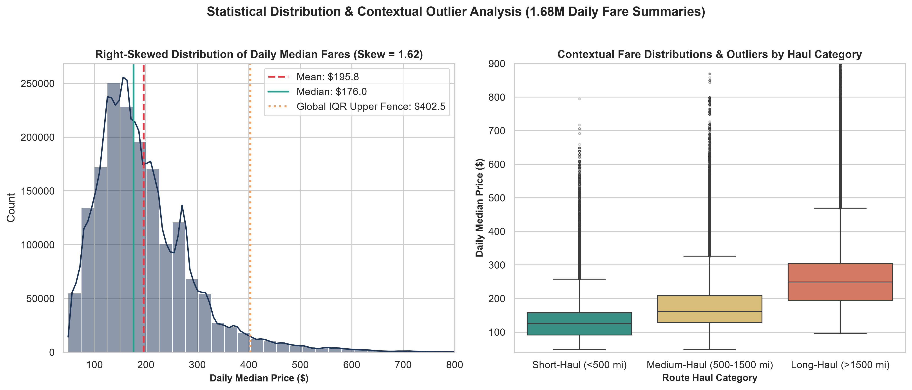
- **Why Route-Contextual IQR Beats Global IQR:** Global IQR on `median_price_usd` ($Q_1 = \$130, Q_3 = \$239, \text{Upper Fence} = \$402.5$) misses `$320` surge fares on short-haul `LAX-LAS` while falsely flagging normal transcontinental fares on `SFO-JFK`. Grouping by route identified **80,574 (`4.79%`) true contextual surge outliers** driven by shorter lead times (`75d` median vs. `94d` normal).

### 8.8 Feature Correlation Matrix
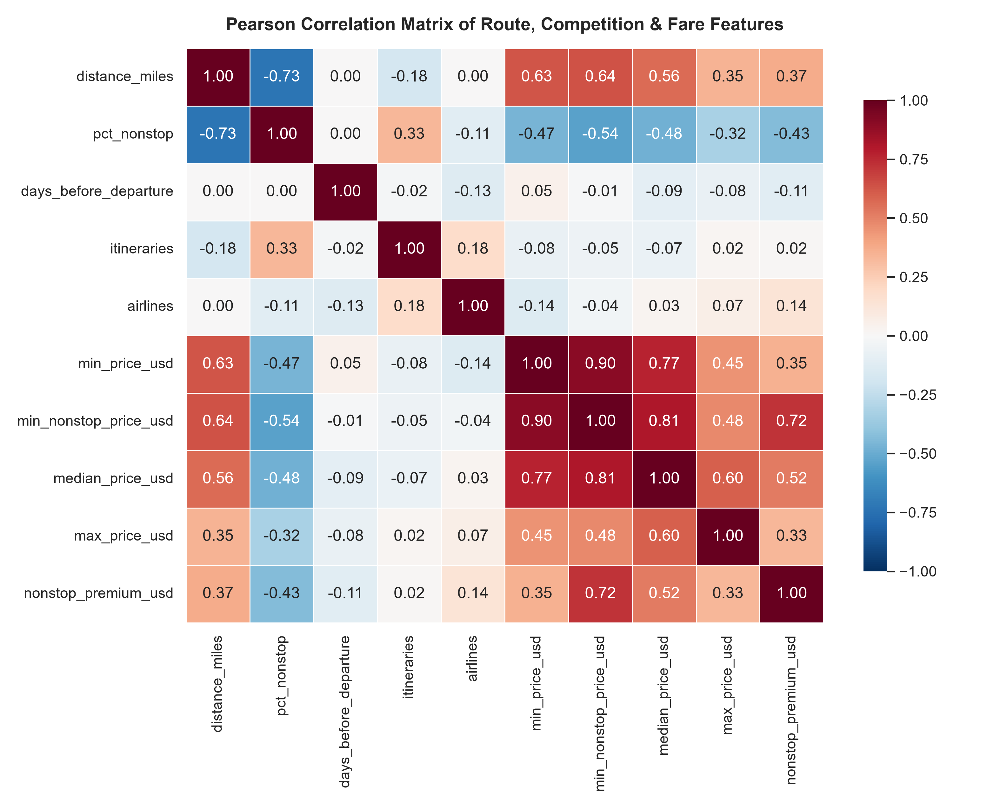

---

## 9. Power BI Dashboard Architecture

All Power BI assets are located in [PowerBI/](PowerBI/):
- **DAX Measures Library:** [PowerBI/01_DAX_Measures_Library.dax](PowerBI/01_DAX_Measures_Library.dax) (18 measures covering KPI Cards, `USERELATIONSHIP`, `AVERAGEX` nonstop premiums, and `DATEADD` MoM trends).
- **Architecture & Build Guide:** [PowerBI/02_PowerBI_Architecture_and_Build_Guide.md](PowerBI/02_PowerBI_Architecture_and_Build_Guide.md).
- **Custom JSON Theme:** [PowerBI/03_Airfare_Executive_Theme.json](PowerBI/03_Airfare_Executive_Theme.json).
- **Interactive HTML Dashboard Prototype:** [PowerBI/Airfare_Time_Machine_Dashboard.html](PowerBI/Airfare_Time_Machine_Dashboard.html).
- **Star Schema Exports:** [PowerBI/Data_Model_Exports/](PowerBI/Data_Model_Exports/).

---

## 10. Machine Learning – Flight Price Prediction

Implemented in [Machine_Learning/01_flight_price_prediction_pipeline.py](Machine_Learning/01_flight_price_prediction_pipeline.py).

### 10.1 Strict Data Leakage Prevention Protocol
1. **No Simultaneous Price Aggregates:** Excluded daily summary metrics (`min_price_usd`, `max_price_usd`, `cheapest_airline`) that are unknown prior to searching.
2. **No Target-Leaked Route Aggregates:** Excluded `routes.csv` `median_price_usd` and `pct_nonstop` (retaining only physical `distance_miles`).
3. **Itinerary-Grouped Train/Test Split (`0` Overlap):** Because identical `itinerary_id`s are scraped across multiple `search_date`s, a naive random row split leaks the exact same flight into both Train and Test. We partitioned the 200,000-row stratified sample (`168,050` unique itineraries across all 50 routes) strictly by **`itinerary_id` groups** (`160,025` Train / `39,975` Test rows; **verified `0` overlapping `itinerary_id`s**).
4. **Train-Only Categorical Encoding:** `OneHotEncoder` + `StandardScaler` (for Ridge) and smoothed target-ordered encoding + 128-bin quantile discretization (for Tree models) were fit strictly on `X_train`.

### 10.2 Model Performance Comparison (Unseen Test Set, $n = 39,975$)

| Model | Train MAE ($) | **Test MAE ($)** | Train RMSE ($) | **Test RMSE ($)** | Train $R^2$ | **Test $R^2$** | Test MAPE (%) |
| :--- | :---: | :---: | :---: | :---: | :---: | :---: | :---: |
| **1. Linear Regression (Ridge)** | $65.41 | **$65.54** | $102.77 | **$102.91** | 0.3702 | **0.3767** | 34.43% |
| **2. Random Forest Regressor** | $61.67 | **$62.03** | $99.74 | **$100.47** | 0.4067 | **0.4060** | 32.56% |
| **3. Gradient Boosting (Baseline)** | $59.32 | **$59.77** | $96.73 | **$97.66** | 0.4421 | **0.4387** | 31.37% |
| **4. Tuned Gradient Boosting (Best)** | **$50.45** | **$53.82** | **$84.35** | **$90.81** | **0.5757** | **0.5147** | **27.95%** |

*(Note: The Tuned Gradient Boosting model achieves a **Median Absolute Error of `$34.70`** on completely unseen flight itineraries, improving Test $R^2$ by **+13.8 percentage points** over Linear Regression. The remaining ~48.5% unexplainable variance reflects unobservable real-time cabin load factors and dynamic booking-class inventory quotas.)*

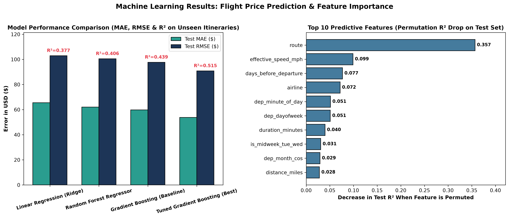

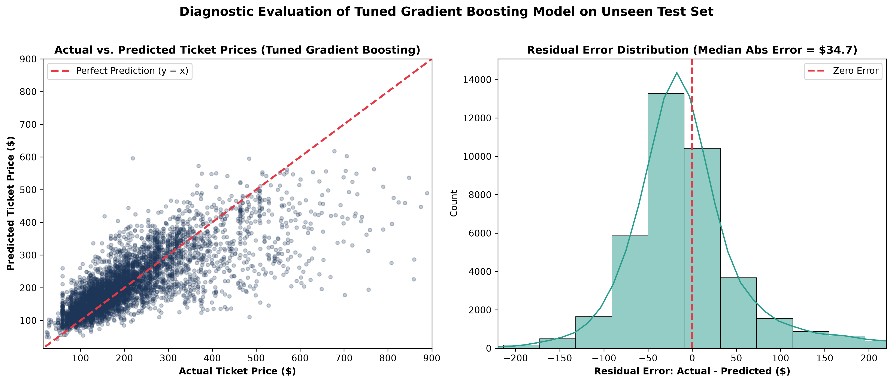

---

## 11. Key Findings Summary

1. **The 49-Day Sweet Spot & ATPCO Cliffs:** US domestic airfares reach their global minimum **48–50 days before departure (`$182.17` median)** and remain flat through the **31–60 day window (`$185.40`)**, before surging by **+53.2% (`$284.07`)** in the final 7–14 days via sharp step increases at Days 21, 14, and 7.
2. **The Tuesday vs. Sunday Gap:** Flying on **Tuesday (`$163.19`)** or **Wednesday (`$165.75`)** saves **$87.60 (-34.9%)** compared to **Sunday (`$250.79`)**.
3. **ULCC Price Anchor vs. Legacy Schedule Dominance:** **Frontier Airlines** offers the lowest daily fare on **48.12%** of all route-days (`$131.05` avg), but with a **130-minute longer average travel duration** than **United (`$204.75`)**, **American (`$225.58`)**, and **Delta (`$231.27`)**, which collectively supply **75.14%** of all flight options.
4. **Economies of Distance:** Ticket price per mile drops by **72.1%** from Short-Haul (`$0.3954/mi`) to Long-Haul (`$0.1104/mi`).

---

## 12. Actionable Business Recommendations

1. **For Travelers & OTA Fare-Alert Engines (Distance-Segmented Booking Rules):**
   - **Short & Medium-Haul (`<1,500 miles`):** Trigger "Buy Now" alerts **31–60 days prior to departure** (saves `$87–$106` vs. last minute and `$7–$11` vs. booking 4–6 months out).
   - **Long-Haul Transcontinental (`>1,500 miles`):** Book **90–150 days in advance** (`$254.92` median) before legacy low-fare buckets deplete, and never cross the **21-day Advance Purchase** threshold.
2. **For Corporate Travel Management:**
   - Shift non-urgent Monday morning / Friday evening / Sunday return trips to **Tuesday/Wednesday** or **Early Morning (`05:00–08:59`) / Evening (`17:00–20:59`)** slots to capture **11%–35% structural cost reductions**.
   - Avoid connecting flights on short/medium routes (only `$9` cheaper for `+5.3 hours` travel time), but allow 1-stop bookings on high-premium transcontinental routes (`SFO-EWR`, `EWR-SFO`, `LAX-BOS`) where nonstop premiums average **`$41–$80`**.
3. **For Loyalty & Frequent-Flyer Optimization:**
   - Redeem miles on fortress-hub and transcontinental corridors (`SFO-JFK`, `DFW-LAX`) where cash fares exceed `$275`, and pay cash on high-competition short-haul corridors (`LAX-SFO` `$109`, `LAS-LAX` `$116`).

---

## 13. Project Structure

```text
Airfare-Time-Machine/
│
├── Dataset/
│   ├── airports.csv                                   # 16 US hub airports lookup table
│   ├── routes.csv                                     # 50 directional routes summary table
│   ├── daily_fares.csv                                # 1,683,033 daily fare summaries (local / Kaggle)
│   ├── flight_prices.parquet                          # 38,584,829 granular observations (local / Kaggle)
│   └── README.md                                      # Dataset download & reproduction instructions
│
├── SQL/
│   ├── 01_schema_ddl.sql                              # MySQL 8.0 3NF + Star Schema DDL & Indexes
│   ├── 02_data_cleaning_and_import.sql                # ELT staging, NULLIF cleaning & quality audits
│   ├── 03_views_and_procedures.sql                    # Analytical Views & Stored Procedures
│   └── 04_business_analysis_queries.sql               # 10 comprehensive business SQL queries
│
├── Python/
│   ├── 01_data_cleaning_and_outliers.py               # Data cleaning & Global vs. Contextual IQR Outliers
│   ├── 02_statistical_and_correlation_analysis.py     # ANOVA, Kruskal-Wallis, t-tests & Correlations
│   └── 03_data_visualization.py                       # Generates 8 publication-grade charts (300 DPI)
│
├── PowerBI/
│   ├── 01_DAX_Measures_Library.dax                    # 18 production DAX measures
│   ├── 02_PowerBI_Architecture_and_Build_Guide.md     # Star Schema model & 3-page layout specification
│   ├── 03_Airfare_Executive_Theme.json                # Importable Power BI custom theme
│   ├── 04_generate_powerbi_exports_and_preview.py     # Exports Star Schema CSVs & renders dashboard preview
│   ├── Airfare_Time_Machine_Dashboard.html            # Standalone interactive HTML BI dashboard
│   └── Data_Model_Exports/                            # Ready-to-load Star Schema tables for Power BI
│
├── Machine_Learning/
│   ├── 01_flight_price_prediction_pipeline.py         # Zero-leakage ML training, tuning & evaluation
│   ├── model_comparison_results.csv                   # Train/Test MAE, RMSE, R², MAPE benchmark table
│   └── feature_importance_results.csv                 # Permutation feature importance scores
│
├── Images/
│   ├── 01_booking_window_j_curve.png
│   ├── 02_airline_price_comparison.png
│   ├── 03_day_of_week_and_time_analysis.png
│   ├── 04_seasonal_monthly_trends.png
│   ├── 05_distance_vs_price_and_yield.png
│   ├── 06_direct_vs_connecting_premium.png
│   ├── 07_outlier_distribution_analysis.png
│   ├── 08_correlation_matrix_heatmap.png
│   ├── 09_powerbi_executive_dashboard_preview.png
│   ├── 10_ml_model_comparison_and_importance.png
│   └── 11_ml_actual_vs_predicted_and_residuals.png
│
├── Documentation/
│   ├── 01_Data_Dictionary_and_Schema_Guide.md         # Full technical data dictionary
│   └── 02_Interview_Preparation_Guide_AZ.md           # Technical interview Q&A guide (Azerbaijani)
│
├── .gitignore
├── requirements.txt
└── README.md
```
